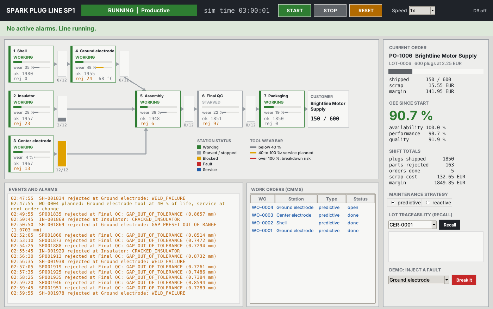
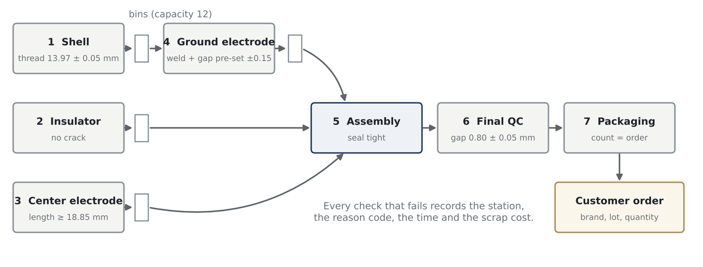
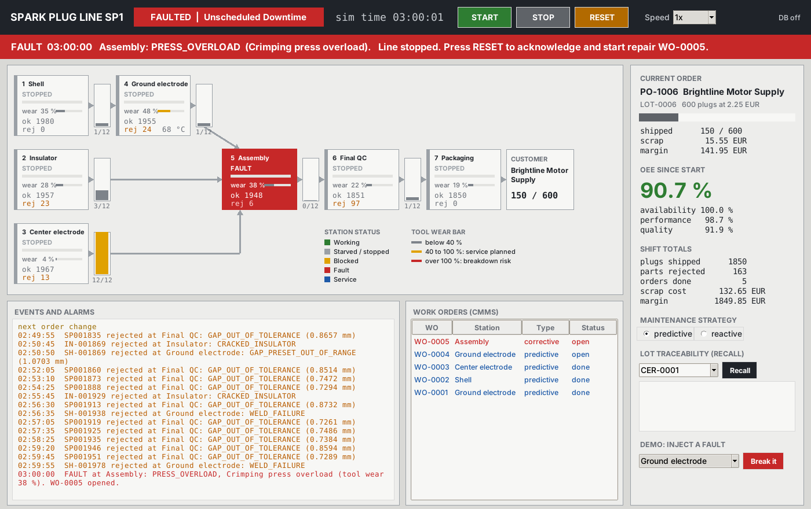
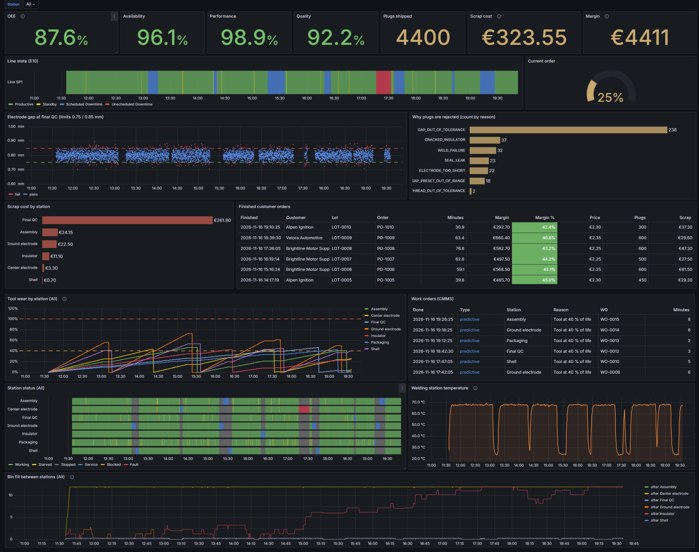
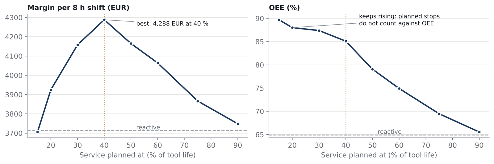

# Spark Plug Production Line SP1

Simulation of a make-to-order production line for spark plugs, with a Python back end, an operator screen (HMI), InfluxDB as time series database and a Grafana dashboard.

Final project for **Advanced Programming**, Applied Mechatronics, SRH University Berlin.
Author: Dany Degheady. Project website: [danydegheady08-lang.github.io](https://danydegheady08-lang.github.io/projects.html#final-project)



## Contents

- [Overview](#overview)
- [The line](#the-line)
- [Quick start](#quick-start)
- [Operator screen](#operator-screen)
- [Dashboard](#dashboard)
- [Maintenance experiment](#maintenance-experiment)
- [Traceability](#traceability)
- [Project structure](#project-structure)
- [Tests](#tests)
- [Limitations](#limitations)
- [Use of AI](#use-of-ai)

## Overview

| Requirement | Implementation |
|---|---|
| Back end in Python, marks defective products and why | Seven stations, each with a check and a reason code; every reject is stored with station, time, measured value and scrap cost |
| HMI with Start, Stop, Reset, state and error display | Tkinter operator screen with alarm banner, fault handling and repair cycle |
| Database | InfluxDB 2.7, one point per second per line and station, plus one per event |
| Dashboard | Grafana 11 with 18 panels, provisioned automatically, station selection variable |

Optional modules, extended:

- **Quality control and cost:** scrap cost per rejected part, margin per customer order, full OEE (availability, performance, quality).
- **CMMS:** predictive and corrective maintenance work orders driven by tool wear.
- **Traceability:** every shipped plug is linked to its material batches and its customer, stored in SQLite for recall queries.

## The line



| # | Station | Check | Reason code | Scrap cost |
|---|---|---|---|---:|
| 1 | Shell | Thread diameter 13.97 ± 0.05 mm | `THREAD_OUT_OF_TOLERANCE` | 0.35 EUR |
| 2 | Insulator | No crack after sintering | `CRACKED_INSULATOR` | 0.30 EUR |
| 3 | Center electrode | Length at least 18.85 mm | `ELECTRODE_TOO_SHORT` | 0.15 EUR |
| 4 | Ground electrode | Weld holds, gap pre-set within 0.15 mm | `WELD_FAILURE`, `GAP_PRESET_OUT_OF_RANGE` | 0.45 EUR |
| 5 | Assembly | Seal tight | `SEAL_LEAK` | 1.05 EUR |
| 6 | Final QC | Gap 0.80 ± 0.05 mm | `GAP_OUT_OF_TOLERANCE` | 1.10 EUR |
| 7 | Packaging | Count matches the order | | |

Buffers of twelve parts sit between the stations, so a breakdown upstream starves the stations after it. Tool wear increases the defect rate and the breakdown risk, which links quality, maintenance and cost. All parameters (cycle times, tolerances, costs, wear) are in [`sparkplug/config.py`](sparkplug/config.py); prices and costs are assumptions.

## Quick start

Requirements: Python 3.10 or newer, Docker Desktop (only for the dashboard).

```powershell
pip install -r requirements.txt

# database and dashboard
cd docker
docker compose up -d
cd ..

# fill InfluxDB with an eight hour shift that ends now
python run_headless.py --influx

# open http://localhost:3000 (admin / admin), dashboard "Spark Plug Line SP1"

# operate the line live; every second is also sent to InfluxDB
python hmi.py --influx --speed 10x
```

Without Docker, the simulation, the HMI and the reports work on their own: `python hmi.py` or `python run_headless.py`.

| Command | Purpose |
|---|---|
| `python hmi.py [--influx] [--speed 30x]` | Operator screen |
| `python run_headless.py [--hours 8] [--strategy reactive] [--influx]` | Simulate a shift and print a report |
| `python recall.py CER-0004` | Customers affected by a material batch |
| `python experiment.py [--sweep]` | Compare maintenance strategies |
| `python -m pytest -q` | Run the tests |

## Operator screen

The screen follows the high performance HMI approach of ISA-101: the normal state is grey, and colour marks only what needs attention (red fault, amber warning or blocked station, blue planned maintenance).

When a station breaks down, the line stops, the banner shows the station, fault code and work order, and START is refused until RESET acknowledges the alarm and starts the repair. A demo control can break any station on purpose.



## Dashboard

Grafana loads its data source and the dashboard from files at start-up ([`docker/grafana`](docker/grafana)); the dashboard is generated by [`docker/build_dashboard.py`](docker/build_dashboard.py). It shows OEE, scrap and margin, the E10 state timeline, every measured gap against its limits, rejects by reason, scrap by station, order margins, tool wear, work orders, station status, welding temperature and buffer levels.



## Maintenance experiment

Both strategies run the same 20 shifts of eight hours (same random seeds). The predictive strategy services a tool at 40 % of its life, at the next order change; the reactive strategy repairs after a breakdown.

| Mean of 20 shifts | Predictive | Reactive |
|---|---:|---:|
| Availability | 92.6 % | 74.3 % |
| OEE | 85.1 % | 64.9 % |
| Breakdowns per shift | 1.9 | 6.6 |
| Plugs shipped | 4,330 | 3,892 |
| Margin per shift | 4,288 EUR | 3,712 EUR |

Predictive maintenance had the higher margin in all 20 shifts. The threshold sweep shows why it is 40 %: OEE keeps rising with earlier service because planned stops do not count against it, but the margin falls again below 40 %.



Raw results: [`docs/experiment_results.csv`](docs/experiment_results.csv).

## Traceability

Every plug records its components, their material batches (steel, ceramic, electrode wire), its measurements, customer and lot.

```text
$ python recall.py CER-0004
Recall for CER-0004: 366 shipped plugs, 2 customer lot(s)
  NordDrive Parts          PO-1004  LOT-0004   139 plugs  serials SP001189 .. SP001335
  Brightline Motor Supply  PO-1005  LOT-0005   227 plugs  serials SP001336 .. SP001585
```

`python recall.py --lot LOT-0003` lists the batches in a customer lot, `python recall.py --serial SP000123` shows the history of one plug.

## Project structure

```text
sparkplug/
  config.py          all parameters: cycle times, tolerances, costs, wear, customers
  line.py            stations, buffers, line states, faults, maintenance, orders
  quality.py         one check per station, returns the reason code
  maintenance.py     CMMS: predictive and corrective work orders
  economics.py       customer orders, margin, OEE
  traceability.py    SQLite store and recall queries
  telemetry.py       InfluxDB writer (line protocol)
hmi.py               operator screen (Tkinter)
run_headless.py      shift simulation without a window
recall.py            traceability queries
experiment.py        maintenance strategy comparison
docker/              InfluxDB and Grafana with provisioning
tests/               pytest tests
docs/                screenshots and experiment results
```

The back end contains no drawing code and no database client in its logic. Front ends only call the operator commands and read `snapshot()`, so the same simulation runs in the HMI, headless and in the tests.

## Tests

```powershell
python -m pytest -q
```

23 tests cover every reject reason, the Start, Stop and Reset logic and fault handling, predictive and urgent maintenance, the margin formula, the OEE calculation, a balance check that no plug is lost between assembly and shipping, reproducibility, the temperature model and the recall query.

## Limitations

- Cycle times, defect rates, costs and prices are assumptions, not plant data.
- Wear is counted in cycles; real wear would be measured, for example through vibration or motor current.
- Scrap is charged to the order running at the time of the reject, which is approximate at an order change.
- The HMI runs in the same process as the simulation and has no user management.
- Credentials in `docker-compose.yml` are for local use only.

## Use of AI

The code was developed with Claude (Anthropic) as a programming assistant. Requirements, product definition and design decisions were mine; every result was run and checked on my machine. Prompts, outputs and corrections are documented in the appendix of the project report.
